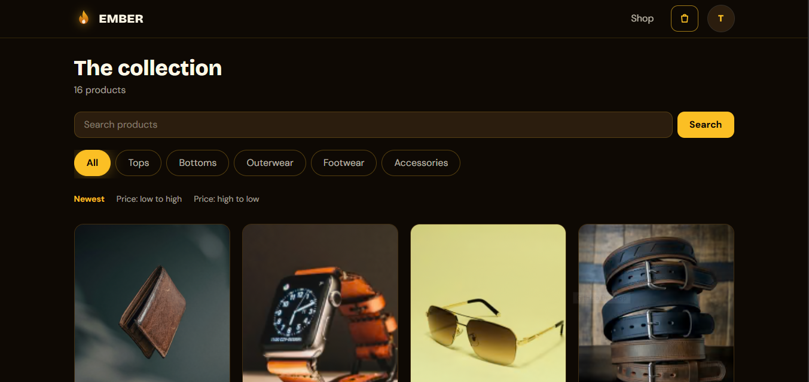
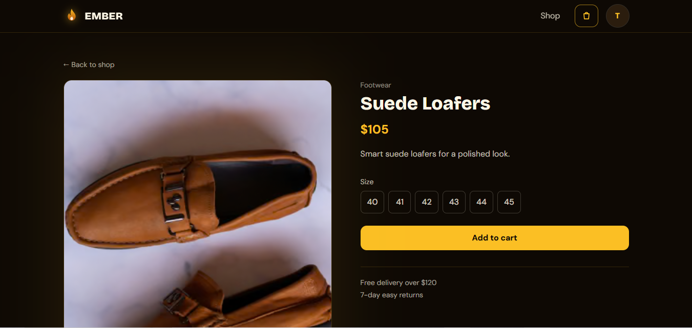
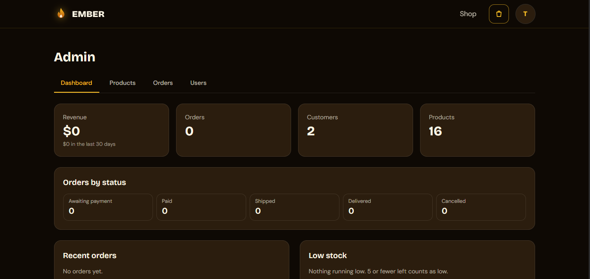
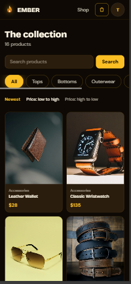
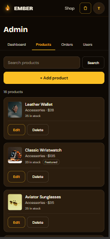
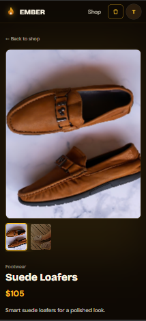
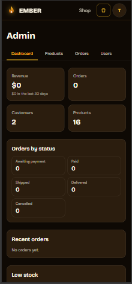
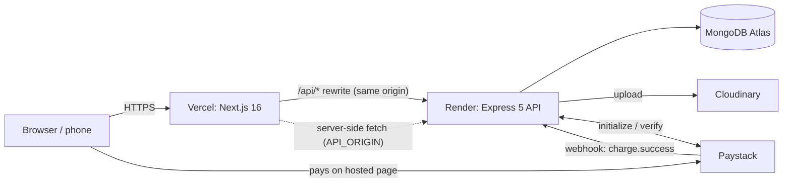
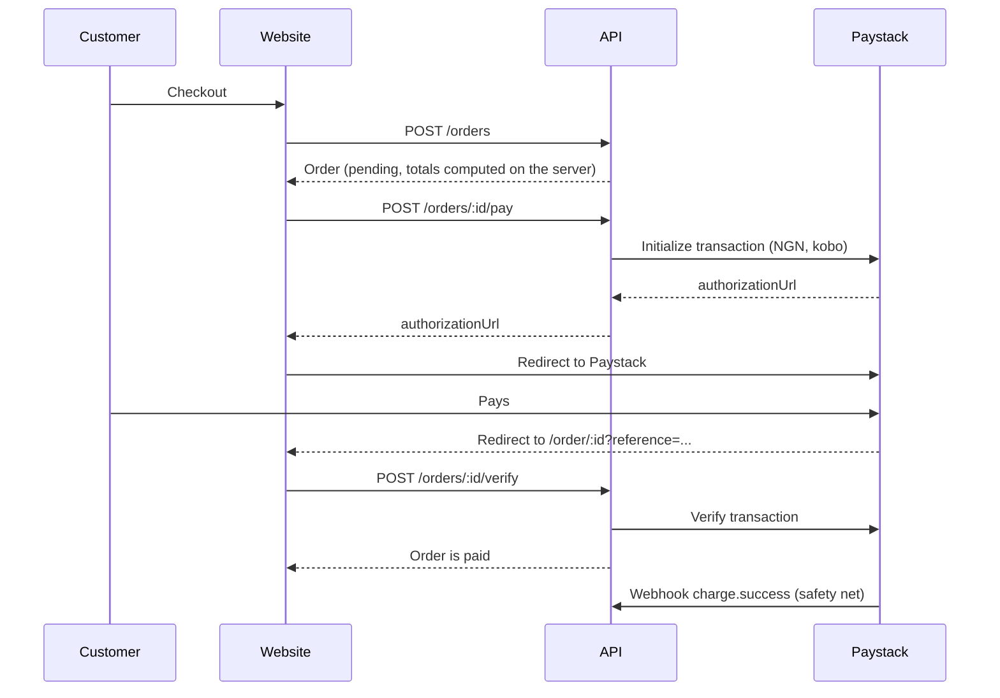

<div align="center">

#  Ember

**Dress sharp. Own the room.**

A full-stack men's fashion store: browse, pick a size, check out and pay, with an admin area to run it.
Built with Next.js, Express, MongoDB, Paystack and Cloudinary.

[**Live demo**](https://ember-menswear.vercel.app) ·
[API health check](https://ember-api-joyl.onrender.com/api/health) ·
[Report a bug](https://github.com/IbnAbass1401/Ember-menswear/issues)


</div>

---

## Table of contents

- [About](#about)
- [Live demo](#live-demo)
- [Screenshots](#screenshots)
- [Features](#features)
- [Tech stack](#tech-stack)
- [Architecture](#architecture)
- [Project structure](#project-structure)
- [Getting started](#getting-started)
- [Environment variables](#environment-variables)
- [Scripts](#scripts)
- [API reference](#api-reference)
- [Design system](#design-system)
- [Deployment](#deployment)
- [Troubleshooting](#troubleshooting)
- [License](#license)

---

## About

Ember is a premium-modern menswear store (prices run from about $20 to $160). It covers the whole path of an online shop: authentication, a product catalogue with search and filters, a persistent cart, server-validated checkout, online payment through Paystack, order tracking for customers, and an admin area for products, orders and customers.

**Why it exists:** a complete, deployable e-commerce project that covers authentication, database management, REST APIs, a responsive UI, error handling and deployment, built step by step.

**Things that make it different from a basic shop demo**

- **The server never trusts the browser.** Prices, delivery fees, stock and totals are all recalculated on the API.
- **Payments are verified twice**: when the customer returns from Paystack, and again through a signed webhook, with idempotent stock handling.
- **Mobile first.** Tap targets are 44px or larger, inputs are 16px so iOS doesn't zoom, and there is no sideways page scroll.
- **iPhone-safe login.** The browser only talks to the site's own `/api` path, which the site forwards to the API, so the login cookie stays first-party.
- **Real image pipeline.** Admins upload photos, the browser shrinks big ones, the API validates them and stores them on Cloudinary, and pages ask Cloudinary for the size they actually need.

Store rules: prices are in USD, delivery is **free when the items total is over $120** and a flat **$8** otherwise, and returns are accepted for **7 days**.

## Live demo

| | |
|---|---|
| Site | https://ember-menswear.vercel.app |
| API | https://ember-api-joyl.onrender.com (`/api/health`) |

> **Payments run in Paystack TEST mode. No real money moves.** Use Paystack's public test card: `4084 0840 8408 4081`, CVV `408`, any future expiry date, PIN `0000`, OTP `123456` if asked.
>
> The API runs on a free Render instance that sleeps when idle, so the first visit after a quiet period can take 30 to 60 seconds. Press **Try again** if you see the error page.

## Screenshots

### Desktop

| Home | Product page |
|---|---|
|  |  |

| Checkout | Admin dashboard |
|---|---|
|  |  |

### Mobile

<p align="center">
  
  
  
  
  
</p>

## Features

**Customers**
- Home page with a responsive hero, a sliding trust ticker and featured products
- Shop with category chips, search, sorting, pagination, skeleton loaders and friendly empty states
- Product page with a swipeable photo gallery, size selection and stock awareness
- Persistent cart drawer (Zustand) with delivery fee logic
- Register, log in, log out, edit profile, change password
- Checkout with server-side totals, Pay now with Paystack, an order page with a status tracker
- Order history

**Admin**
- Dashboard: revenue (total and last 30 days), orders by status, customers, product and stock counts, recent orders
- Products: search, add, edit, delete, multi-photo upload with reorder and remove
- Orders: status filter, detail page, one-way status flow (paid, shipped, delivered)
- Customers: search, order count and total spent

**Platform**
- SEO: per-page titles and descriptions, share cards (Open Graph), product structured data, sitemap and robots
- Site icon and Apple touch icon
- Soft page transitions that respect "reduce motion"
- Production build verified, error and not-found pages

## Tech stack

| Layer | Technology |
|---|---|
| Frontend | Next.js 16 (App Router, Turbopack), TypeScript, Tailwind CSS v4, Framer Motion, Zustand |
| Backend | Node.js 20+, Express 5, Mongoose 9, Zod 4 |
| Database | MongoDB Atlas |
| Auth | JWT in an httpOnly cookie, bcryptjs |
| Payments | Paystack (NGN, test mode) |
| Images | Cloudinary (upload and on-the-fly resizing), multer |
| Fonts | Bricolage Grotesque and DM Sans, self-hosted with Fontsource |
| Hosting | Vercel (site), Render (API), MongoDB Atlas (data) |

## Architecture



**Why the `/api` rewrite?** The browser calls `/api/...` on the site's own address and Next.js forwards it to the API. The login cookie is therefore first-party, which keeps login working on iPhones and avoids cross-site cookie blocking. Server-side pages (home, shop, product, sitemap) call the API directly using `API_ORIGIN`.

## Project structure

```
Ember-menswear/
├── client/                      Next.js site
│   ├── app/
│   │   ├── layout.tsx  page.tsx  template.tsx  error.tsx  not-found.tsx
│   │   ├── icon.tsx  apple-icon.tsx  opengraph-image.tsx  robots.ts  sitemap.ts
│   │   ├── shop/                (page, layout with SEO, loading skeleton)
│   │   ├── product/[slug]/      (page with metadata + structured data, loading skeleton)
│   │   ├── login/  register/  checkout/  order/[id]/
│   │   ├── account/             (overview, orders)
│   │   └── admin/               (dashboard, products, orders, users)
│   ├── components/
│   │   ├── layout/   Logo, Navbar, UserMenu
│   │   ├── home/     TrustMarquee
│   │   ├── cart/     CartDrawer, CartHydrator
│   │   ├── product/  ProductCard, ProductCardSkeleton, ProductGallery, AddToCart
│   │   ├── ui/       Photo, Skeleton, Field
│   │   ├── auth/     LoginForm, RegisterForm, RequireAuth
│   │   ├── account/  AccountNav, AccountSummary, ProfileForm, PasswordForm, OrderHistory
│   │   ├── checkout/ CheckoutForm
│   │   ├── order/    OrderView, OrderProgress
│   │   └── admin/    AdminNav, Dashboard, ProductList, ProductForm, ImageUploader, ...
│   ├── lib/          api.ts (server fetch), client-api.ts, image-resize.ts, site.ts, flame-mark.tsx, ...
│   ├── store/        cart.ts, auth.ts (Zustand)
│   └── public/       hero.jpg, hero-mobile.jpg
├── server/                      Express API (ESM)
│   └── src/
│       ├── app.js  server.js  seed.js
│       ├── config/       db.js (connect with retries), cloudinary.js
│       ├── models/       User, Product, Order
│       ├── controllers/  auth, product, order, payment, webhook, user, admin*, upload
│       ├── routes/       auth, product, order, payment, user, admin
│       ├── middleware/   auth (protect, restrictTo), validate, upload, errorHandler
│       ├── validators/   Zod schemas
│       └── utils/        AppError, token, paystack, markOrderPaid
└── docs/                        HANDOFF.md, screenshots/
```

## Getting started

### Prerequisites

- **Node.js 20.9 or newer** (developed on Node 24) and npm
- A free **MongoDB Atlas** cluster and a database user with `readWrite` on a database named `ember`
- A **Paystack** account (test keys are enough)
- A free **Cloudinary** account

### 1. Clone and install

```bash
git clone https://github.com/IbnAbass1401/Ember-menswear.git
cd Ember-menswear
npm install --prefix server
npm install --prefix client
```

### 2. Create the environment files

`server/.env`

```ini
PORT=5000
NODE_ENV=development
CLIENT_URL=http://localhost:3000
MONGO_URI=mongodb+srv://<user>:<password>@<cluster>.mongodb.net/ember?retryWrites=true&w=majority
JWT_SECRET=<a-long-random-string>
JWT_EXPIRES_IN=7d
PAYSTACK_SECRET_KEY=sk_test_xxxxxxxxxxxxxxxx
USD_NGN_RATE=1500
CLOUDINARY_CLOUD_NAME=<your-cloud-name>
CLOUDINARY_API_KEY=<your-api-key>
CLOUDINARY_API_SECRET=<your-api-secret>
```

`client/.env.local`

```ini
NEXT_PUBLIC_API_URL=http://localhost:5000/api
```

> Never commit these files. Use a database password with letters and numbers only, since special characters can break the connection string.

### 3. Run it (two terminals)

```bash
npm run dev --prefix server    # API on http://localhost:5000
npm run dev --prefix client    # site on http://localhost:3000
```

The API can take a while to print `MongoDB connected` on a slow network. nodemon does **not** watch `.env`, so after editing `server/.env` type `rs` in the server terminal.

### 4. Add sample data

```bash
npm run seed --prefix server
```

> ⚠️ The seed **deletes all existing products** before inserting 16 sample ones. Never run it against a store with real products. Photos are added afterwards from the admin area.

### 5. Create your admin

1. Register a normal account on the site.
2. In MongoDB Atlas open **Browse Collections → ember → users**, edit your user and change `role` from `"user"` to `"admin"`.
3. Log out and back in, then open `/admin`.

## Environment variables

### API (`server/.env`, or the Render dashboard)

| Variable | Required | Description |
|---|---|---|
| `PORT` | local only | Port for the API (Render sets it for you) |
| `NODE_ENV` | yes | `development` locally, `production` when deployed (controls cookie flags and error stacks) |
| `CLIENT_URL` | yes | Allowed site origin(s), comma-separated. Also used for the Paystack return link |
| `MONGO_URI` | yes | Atlas connection string ending in `/ember?...` |
| `JWT_SECRET` | yes | Long random string. Use a different one in production |
| `JWT_EXPIRES_IN` | yes | Token lifetime, e.g. `7d` |
| `PAYSTACK_SECRET_KEY` | yes | `sk_test_...` for testing, `sk_live_...` when live. Also verifies webhook signatures |
| `USD_NGN_RATE` | yes | Fixed dollar-to-naira rate used when charging, e.g. `1500`. Keep it roughly current |
| `CLOUDINARY_CLOUD_NAME` / `_API_KEY` / `_API_SECRET` | yes | Image upload credentials |
| `TRUST_PROXY_HOPS` | optional | Number of proxies in front of the API (default `1`; use `2` behind Vercel and Render) |

### Site (`client/.env.local`, or the Vercel dashboard)

| Variable | Local | Production | Description |
|---|---|---|---|
| `NEXT_PUBLIC_API_URL` | `http://localhost:5000/api` | `/api` | Where the **browser** sends API calls |
| `API_ORIGIN` | not needed | `https://<your-api>.onrender.com` | Where the **server** and the rewrite send API calls (no `/api`, no trailing slash) |
| `NEXT_PUBLIC_SITE_URL` | defaults to `http://localhost:3000` | `https://<your-site>.vercel.app` | Public address for share cards, sitemap and canonical links |

> `NEXT_PUBLIC_*` values are baked into the site **at build time**. After changing one, redeploy without the build cache. On Vercel, save these as plain (Config) variables, not Secrets, so you can read them back.

## Scripts

| Where | Command | What it does |
|---|---|---|
| `server` | `npm run dev` | API with nodemon (auto restart) |
| `server` | `npm start` | API with node (production) |
| `server` | `npm run seed` | Wipes and re-seeds products (**destructive**) |
| `client` | `npm run dev` | Next.js dev server |
| `client` | `npm run build` | Production build |
| `client` | `npm start` | Serve the production build |

## API reference

Base path: `/api`. Errors always look like `{ "success": false, "message": "...", "stack": "..." }` (the `stack` only appears in development).

| Area | Method and path | Access | Notes |
|---|---|---|---|
| Health | `GET /health` | public | `{ status: "ok" }` |
| Auth | `POST /auth/register`, `POST /auth/login`, `POST /auth/logout`, `GET /auth/me` | public / cookie | Register and login are rate limited |
| Users | `PATCH /users/me` | user | Update name |
| | `PATCH /users/me/password` | user | `{ currentPassword, newPassword }`, rate limited |
| Products | `GET /products` | public | `page`, `limit` (max 48), `category`, `search`, `minPrice`, `maxPrice`, `sort`, `featured` |
| | `GET /products/:slug` | public | Full product |
| | `POST /products`, `PATCH /products/:id`, `DELETE /products/:id` | admin | |
| Orders | `POST /orders` | user | `{ items: [{ productId, size?, qty }], shippingAddress }`. Prices are ignored and recalculated |
| | `GET /orders/mine`, `GET /orders/:id` | owner | `:id` also returns `estimatedNGN` |
| | `POST /orders/:id/pay` | owner | Starts a Paystack transaction, returns `authorizationUrl` |
| | `POST /orders/:id/verify` | owner | `{ reference }`, confirms payment with Paystack |
| Payments | `POST /payments/webhook` | Paystack | Raw body, HMAC SHA512 signature check |
| Admin | `GET /admin/stats` | admin | Revenue, counts, recent orders |
| | `GET /admin/orders`, `GET /admin/orders/:id` | admin | `status`, `page`, `limit` |
| | `PATCH /admin/orders/:id/status` | admin | One-way: paid to shipped to delivered, or pending to cancelled |
| | `GET /admin/users` | admin | Search, order count, total spent |
| | `POST /admin/uploads` | admin | Multipart field `images`, up to 6 files, JPG/PNG/WEBP, 5MB each, returns Cloudinary URLs |

## How payments work



## Design system

**Amber Noir**: dark, warm, with glow used only to guide action.

| Token | Hex | Use |
|---|---|---|
| `noir` | `#0E0904` | Page background |
| `surface` | `#2B1D0E` | Cards, drawer, inputs |
| `ember` | `#FBBF24` | Primary buttons, highlights, glow |
| `rust` | `#B45309` | Secondary, hover, gradients |
| `cream` | `#FFF8E7` | Text |

Fonts: **Bricolage Grotesque** (headings, `font-display`) and **DM Sans** (body). Glow is reserved for primary button hover, the selected size, the active filter chip, the cart badge and drawer edge, and a soft backlight behind product cards on hover. No glowing text, no pulsing in the product grid, and calm forms and checkout.

## Deployment

**Database:** MongoDB Atlas. Create a dedicated user with `readWrite` on `ember` only.

### API on Render

| Setting | Value |
|---|---|
| Root directory | `server` |
| Build command | `npm install` |
| Start command | `npm start` |
| Environment | the API variables above, with `NODE_ENV=production`, a **new** `JWT_SECRET`, `TRUST_PROXY_HOPS=2`, and `CLIENT_URL` set to your site address |

### Site on Vercel

| Setting | Value |
|---|---|
| Root directory | `client` |
| Environment | `NEXT_PUBLIC_API_URL=/api`, `API_ORIGIN=https://<your-api>.onrender.com`, `NEXT_PUBLIC_SITE_URL=https://<your-site>.vercel.app` |

### Going live with real payments

Activate your Paystack business, replace `PAYSTACK_SECRET_KEY` with the live key, set the **Live Webhook URL**, and test with one small real payment. Keep `USD_NGN_RATE` current, and consider a paid plan so the API never sleeps.

## Troubleshooting

| Symptom | Likely cause and fix |
|---|---|
| Pages show "Something went wrong" and "fetch failed" | The API isn't running or reachable. Start it, or check `API_ORIGIN` / `NEXT_PUBLIC_API_URL` |
| Deployed site says "Can't reach the server" and the console mentions `localhost:5000` and CORS | `NEXT_PUBLIC_API_URL` wasn't set when the site was built. Set it to `/api` as a plain variable and redeploy without cache |
| Changing a `NEXT_PUBLIC_*` value changes nothing | Those are baked in at build time. Rebuild |
| Changing `server/.env` changes nothing | nodemon doesn't watch `.env`. Type `rs` in the server terminal |
| `MongoDB connection failed ... timed out` | Your network may be blocking Atlas or dropping the connection. Retry, switch network, and check Atlas **Network Access** |
| First request is very slow on the live site | The free Render instance was asleep. Wait up to a minute |
| `401` on `/api/auth/me` while logged out | Expected, nobody is logged in |
| "Image uploads are not configured" | The three `CLOUDINARY_*` variables are missing on the API |
| Order stays pending after paying and closing the tab | Webhook not reaching the API: check the webhook URL and that `PAYSTACK_SECRET_KEY` matches the dashboard key |
| Paid order but the customer sees a stock problem | The item sold out between checkout and payment (`stockIssue`). Refund manually in Paystack |

## License

Released under the MIT License. You are free to use, copy, modify and distribute the code, as long as the copyright notice and license text are kept.

---

Built by Abass A.